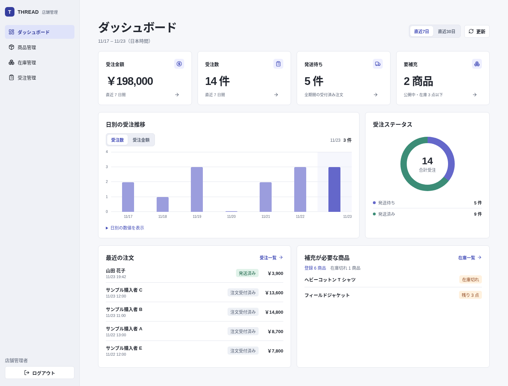

# THREAD

DevQuest で改修するアパレル EC の演習用テンプレートです。商品を検索し、演習用アカウントで模擬注文を作成できます。管理者は商品情報・在庫・受注を管理できます。

## 画面例

### EC サイトのトップページ


### 店舗管理のダッシュボード



グラフと注文一覧には演習用のサンプル受注を表示しています。

## 初回セットアップ

Node.js 22.12 以上または 24、npm、Docker Compose v2 を用意します。GitHub の **Use this template** から個人所有の公開リポジトリを作成し、ローカルの VS Code で開きます。リポジトリを DevQuest に登録してください。

```sh
npm ci
cp .env.example .env
```

`.env` の `THREAD_JWT_SECRET` に自分の演習環境だけで使うランダムな値を32文字以上で設定します。たとえば `node -p "require('node:crypto').randomBytes(32).toString('hex')"` で生成できます。DB 接続設定はローカル Compose 用のサンプルが入っています。

```sh
set -a
. ./.env
set +a
docker compose up -d --wait
npm run db:generate
npm run db:migrate
npm run db:seed
npm run dev
```

`npm run dev` で3つのアプリを同時に起動します。NestJS はリポジトリ直下の `.env` を自動で読み込みます。環境変数をエクスポート済みの場合は、その値が優先されます。Prisma の初期化コマンドを実行するときは、上記の手順で先に `.env` を読み込んでください。

更新後に `@thread/shared` が見つからない場合は、開発サーバーを `Ctrl+C` で停止し、リポジトリ直下で `npm ci` を実行してから `npm run dev` で起動します。`THREAD_JWT_SECRET` のエラーが出る場合は、同じルートの `.env` に32文字以上の値が設定されていることを確認して再起動します。

個別に起動する場合も、ログインや管理操作を行う前に共通 API と DB を起動してください。

| アプリ | URL | 個別起動 | 実装 |
| --- | --- | --- | --- |
| EC サイト | `http://localhost:5174/` | `npm run dev:store` | `web/` |
| 店舗管理 | `http://localhost:5175/` | `npm run dev:admin` | `admin/` |
| 共通 NestJS API | `http://localhost:3001/api/docs`（OpenAPI） | `npm run dev:api` | `api/` |

PostgreSQL はローカルの 55432 番ポートで共通利用します。初期データ投入を再実行しても、商品やアカウントを初期値に戻しません。

| 用途 | メール | 演習用パスワード |
| --- | --- | --- |
| EC サイト専用 | `customer@example.test` | `thread-customer` |
| 店舗管理専用 | `admin@example.test` | `thread-admin` |

これらはローカル演習専用アカウントです。THREAD の DB や API を一般公開する構成では使用しないでください。決済処理は模擬です。

## 購入手続き

EC サイトでログインして商品をカートに入れると、**カート → 配送先入力 → 注文確認 → 完了**の順に進めます。配送先と電話番号を入力し、確認画面で商品・数量・金額・配送先を確認します。送料は無料、支払い方法は模擬の代金引換です。入力には演習用の架空の住所を使ってください。

確定時に最新のカート・金額・在庫を照合します。同じ確認画面から確定を再送しても注文番号は変わりません。完了画面では注文番号を表示し、注文履歴と店舗管理から保存された配送先を確認できます。

既存クローンを更新した場合は、`.env` を読み込んだターミナルで `npm run db:generate` と `npm run db:migrate` を実行してから、開発サーバーを再起動してください。配送先の列を追加するマイグレーションで、過去の注文も表示できます。

## 店舗管理

店舗管理を別のタブで開き、管理者アカウントでログインします。ダッシュボードに登録商品数・在庫切れ・発送待ちが表示されます。

- **商品**では、新規登録と商品名・説明・カテゴリー・価格・公開状態の編集ができます。
- **在庫**では、在庫切れを絞り込んで在庫数を更新できます。別の操作で先に在庫が変わった場合は、一覧を更新してから入力し直してください。
- **受注**では、注文番号や購入者で検索し、注文行を開くと明細を確認できます。注文受付済みの注文は発送済みに変更できます。

演習の初期状態では、非公開の商品もストアの商品一覧に表示されます。この挙動は DEV-104 の改修対象です。

## ログインと API の接続

ログイン先は EC が `POST /api/auth/store/login`、店舗管理が `POST /api/auth/admin/login` です。用途が異なるアカウントではログインできません。以前の共通ログインで発行されたトークンは有効範囲が異なるため、分離後はログインし直してください。

各アプリはログイン時に発行されたセッションを別々にブラウザへ保存します。同じブラウザ・URL で開き直すと、ログインから1時間は共通 API の確認を経て再開できます。以前にタブ内だけに保存されたセッションは、更新後に一度ログインし直してください。API は署名、有効期限、発行元、トークンの対象アプリ、現在の DB ロールを検証します。Vite は各アプリの `/api` を共通 API に中継します。別ホストで起動する場合は、`THREAD_STORE_ORIGINS` と `THREAD_ADMIN_ORIGINS` に対応する URL のオリジンをコンマ区切りで設定します。

## 開発・採点

- `web/src/features/` に顧客向けの商品・カート・注文・認証があります。
- `admin/src/features/` に管理者専用のログイン、ダッシュボード、商品・在庫・受注管理があります。
- `packages/shared/` は共通の型、API クライアント、認証状態の処理を提供します。画面とビルドは `web/` と `admin/` がそれぞれ持ちます。
- `api/src/` では NestJS の機能モジュールごとに、コントローラー、サービス、DB リポジトリ、入力 DTO を分けています。
- `api/prisma/` に PostgreSQL のスキーマ・マイグレーション・初期データがあります。DevQuest 本体の Supabase とは別の DB です。
- `grading/` と `.github/workflows/` は管理者が保守します。依存関係、ビルド設定、テスト、初期データも採点の前提として保護されています。

```sh
npm run typecheck
npm run lint
npm test
npm run build
npm run grade -- task/DEV-101
```

通常のテストは初期状態で成功します。課題別テストは対応する改修が完了するまで、対象条件で失敗します。DEV-101〜104 では在庫表示・価格ソート・カテゴリ切り替え・公開用商品一覧を順番に改修します。新しい課題では以前の課題の挙動も回帰テストで確認します。

DevQuest の指定ブランチにコミットを push し、Actions の結果を確認します。合格したら GitHub で自分で PR を作り、main へマージします。次回も最新の main から始めます。以前の修正をリセットする必要はありません。DEV-105〜112 は今後追加予定です。

**DEV-111 の予定**は、既存の数量更新を土台に、変更前後の数量・担当者・日時・理由を記録し、店舗管理から履歴を確認できるようにすることです。履歴の実装と採点は課題公開時に追加します。

### 旧版から演習を進めている場合

今回の採点基準は `thread-checkout-v1` です。`thread-split-v1` で演習中のリポジトリは、その版で引き続き採点できます。購入手続きの変更を取り込む場合は、以下の移行差分を適用します。テンプレートから作られたリポジトリは上流とコミット履歴を共有しないため、既存の修正と衝突する箇所は Git で解決してください。

```sh
git switch main
git pull --ff-only origin main
git fetch https://github.com/okuda1506/devquest-fashion-template.git tag thread-split-v1 tag thread-checkout-v1
git diff --binary --find-renames thread-split-v1 thread-checkout-v1 | git apply --3way --index
git diff --cached
git commit -m "THREAD の購入手続きに追従"
git push origin main
npm ci
```

EC と店舗管理を分離する前から演習している場合は、両タグに加えて `7d4f1f33a70257bf4bf6b28e0947a6180840a81b` を取得し、差分の開始点を `thread-split-v1` の代わりにそのコミットにします。作業中の課題があれば、移行済みの main を作業ブランチに取り込んでから再提出します。移行でコミット履歴や DevQuest の進捗を初期化する必要はありません。

作業を終えるときは開発サーバーを停止し、`docker compose down` を実行します。DB の名前付きボリュームは保持されます。
