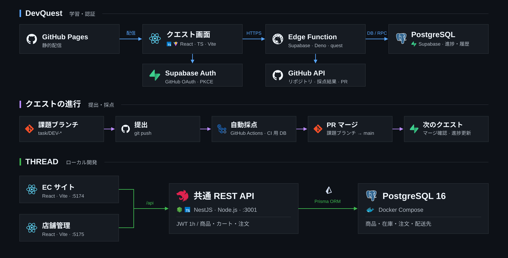

# THREAD

DevQuest で改修するアパレル EC の演習用テンプレートです。商品を検索し、演習用アカウントで模擬注文を作成できます。管理者は商品情報・在庫・受注を管理できます。

## 画面例

### EC サイトのトップページ


### 店舗管理のダッシュボード


グラフと注文一覧には演習用のサンプル受注を表示しています。

## システムアーキテクチャ



## 初回セットアップ

まず [DevQuest](https://okuda1506.github.io/devquest-app/) をブラウザで開き、初出勤の「環境構築」まで進めます。GitHub で **Use this template** を選び、自分の個人アカウントが所有する公開リポジトリを作って DevQuest に登録してください。手元で起動するのは THREAD の EC サイト、店舗管理画面、API、DB です。

### Windows

1. **管理者として PowerShell** を開き、Ubuntu が入っていなければ次のコマンドを実行します。再起動が求められたら実行し、Ubuntu を起動して Linux 用のユーザーを作ります。

   ```powershell
   wsl --install -d Ubuntu
   wsl --list --verbose
   ```

   一覧の Ubuntu の VERSION が 2 であることを確認します。既存の Ubuntu が VERSION 1 の場合は PowerShell で `wsl --set-version Ubuntu 2` を実行します。ディストリビューション名は一覧に表示された名前を使ってください。

2. Windows に [Docker Desktop](https://docs.docker.com/desktop/setup/install/windows-install/) をインストールして起動します。**Settings → General** で WSL 2 ベースのエンジンを使い、**Resources → WSL integration** で Ubuntu を有効にします。
3. **Ubuntu のターミナル**で以下を実行します。Node.js は Ubuntu 側に [nvm](https://github.com/nvm-sh/nvm#installing-and-updating) をインストールしてから導入します。

   ```bash
   sudo apt update
   sudo apt install -y git curl ca-certificates
   nvm install 24
   nvm use 24
   node --version
   npm --version
   docker compose version
   ```

4. 以下の共通手順も **Ubuntu のターミナル**で実行します。クローン先は `/mnt/c` 以下よりも Ubuntu のホームディレクトリを使うと、ファイル監視や依存関係のインストールを扱いやすくなります。VS Code を使う場合は **WSL** 拡張を入れ、Ubuntu 側でリポジトリを開きます。

### macOS

1. ターミナルで Git を確認し、必要に応じて `xcode-select --install` でコマンドラインツールを入れます。
2. [Node.js](https://nodejs.org/) 24、または 22.12 以上の Node.js 22 と npm をインストールします。Homebrew を使う場合は `brew install node@24` を実行し、表示された PATH 設定を適用します。
3. [Docker Desktop](https://docs.docker.com/desktop/setup/install/mac-install/) をインストールして起動し、以下をターミナルで確認します。

   ```bash
   git --version
   node --version
   npm --version
   docker compose version
   ```

4. 以下の共通手順を **macOS のターミナル**で実行します。

### WindowsとmacOSの共通起動手順

DevQuest が表示したクローンコマンドを使うか、次の例の `YOUR_GITHUB_ID` と `YOUR_REPOSITORY` を登録した演習リポジトリに置き換えます。

```bash
git clone https://github.com/YOUR_GITHUB_ID/YOUR_REPOSITORY.git
cd YOUR_REPOSITORY
```

```sh
npm ci
cp .env.example .env
```

`.env` の `THREAD_JWT_SECRET` に自分の演習環境だけで使うランダムな値を32文字以上で設定します。たとえば `node -p "require('node:crypto').randomBytes(32).toString('hex')"` で生成できます。DB 接続設定はローカル Compose 用のサンプルが入っています。

```sh
set -a
. ./.env
set +a
docker compose up -d --wait
npm run db:generate
npm run db:migrate
npm run db:seed
npm run dev
```

`npm run dev` で3つのアプリを同時に起動します。NestJS はリポジトリ直下の `.env` を自動で読み込みます。環境変数をエクスポート済みの場合は、その値が優先されます。Prisma の初期化コマンドを実行するときは、上記の手順で先に `.env` を読み込んでください。

起動後は Windows または macOS のブラウザで EC サイトと店舗管理を開き、DevQuest の起動確認にチェックを入れます。

更新後に `@thread/shared` が見つからない場合は、開発サーバーを `Ctrl+C` で停止し、リポジトリ直下で `npm ci` を実行してから `npm run dev` で起動します。

`THREAD_JWT_SECRET` のエラーが出る場合は、リポジトリ直下の `.env` を確認します。値が未設定・空、または32文字未満の場合は、以下のコマンドで64文字のランダムな値を生成します。

```sh
node -p "require('node:crypto').randomBytes(32).toString('hex')"
```

出力された値を `.env` の `THREAD_JWT_SECRET=` の右側に貼り付けて保存します。設定行がなければ追加してください。シェルに古い値を読み込んでいる場合は、`unset THREAD_JWT_SECRET` で解除します。その後、`npm run dev` で再起動します。

個別に起動する場合も、ログインや管理操作を行う前に共通 API と DB を起動してください。

| アプリ | URL | 個別起動 | 実装 |
| --- | --- | --- | --- |
| EC サイト | `http://localhost:5174/` | `npm run dev:store` | `web/` |
| 店舗管理 | `http://localhost:5175/` | `npm run dev:admin` | `admin/` |
| 共通 NestJS API | `http://localhost:3001/api/docs`（OpenAPI） | `npm run dev:api` | `api/` |

PostgreSQL はローカルの 55432 番ポートで共通利用します。初期データ投入を再実行しても、商品やアカウントを初期値に戻しません。

| 用途 | メール | 演習用パスワード |
| --- | --- | --- |
| EC サイト専用 | `customer@example.test` | `thread-customer` |
| 店舗管理専用 | `admin@example.test` | `thread-admin` |

これらはローカル演習専用アカウントです。THREAD の DB や API を一般公開する構成では使用しないでください。決済処理は模擬です。

## 購入手続き

EC サイトでログインして商品をカートに入れると、**カート → 配送先入力 → 注文確認 → 完了**の順に進めます。配送先と電話番号を入力し、確認画面で商品・数量・金額・配送先を確認します。送料は無料、支払い方法は模擬の代金引換です。入力には演習用の架空の住所を使ってください。

確定時に最新のカート・金額・在庫を照合します。同じ確認画面から確定を再送しても注文番号は変わりません。完了画面では注文番号を表示し、注文履歴と店舗管理から保存された配送先を確認できます。

既存クローンを更新した場合は、`.env` を読み込んだターミナルで `npm run db:generate` と `npm run db:migrate` を実行してから、開発サーバーを再起動してください。配送先の列を追加するマイグレーションで、過去の注文も表示できます。

## 店舗管理

店舗管理を別のタブで開き、管理者アカウントでログインします。ダッシュボードに登録商品数・在庫切れ・発送待ちが表示されます。

- **商品**では、新規登録と商品名・説明・カテゴリー・価格・公開状態の編集ができます。
- **在庫**では、在庫切れを絞り込んで在庫数を更新できます。別の操作で先に在庫が変わった場合は、一覧を更新してから入力し直してください。
- **受注**では、注文番号や購入者で検索し、注文行を開くと明細を確認できます。注文受付済みの注文は発送済みに変更できます。

演習の初期状態では、非公開の商品もストアの商品一覧に表示されます。この挙動は DEV-104 の改修対象です。

## ログインと API の接続

ログイン先は EC が `POST /api/auth/store/login`、店舗管理が `POST /api/auth/admin/login` です。用途が異なるアカウントではログインできません。以前の共通ログインで発行されたトークンは有効範囲が異なるため、分離後はログインし直してください。

各アプリはログイン時に発行されたセッションを別々にブラウザへ保存します。同じブラウザ・URL で開き直すと、ログインから1時間は共通 API の確認を経て再開できます。以前にタブ内だけに保存されたセッションは、更新後に一度ログインし直してください。API は署名、有効期限、発行元、トークンの対象アプリ、現在の DB ロールを検証します。Vite は各アプリの `/api` を共通 API に中継します。別ホストで起動する場合は、`THREAD_STORE_ORIGINS` と `THREAD_ADMIN_ORIGINS` に対応する URL のオリジンをコンマ区切りで設定します。

## 開発・採点

- `web/src/features/` と `admin/src/features/` は画面を機能ごとに整理しています。
- `packages/shared/src/` は共通の API 通信、セッション、型、表示用の処理を提供します。
- `api/src/modules/` は業務機能ごとに Controller・Service・Repository・DTO を配置しています。EC と店舗管理が同じ機能を使う場合は Controller を分けます。
- 購入確認と注文確定は `checkout/`、注文履歴と受注管理は `orders/` にあります。[コード構成と処理の探し方](docs/code-architecture.md)

```sh
npm run typecheck
npm run lint
npm test
npm run build
npm run grade -- task/DEV-101
```

通常のテストは初期状態で成功します。DEV-101〜143 の43件を指定順に解放します。DEV-141〜143 は上級チャプターの最後に届きます。指定ブランチは DevQuest の課題画面で確認できます。各課題の完了条件と先に完了した課題の回帰テストを GitHub Actions が実行します。未改修のテンプレートでは各課題に未達の条件があり、そのテストは失敗します。

### 演習上の本番環境について

> **注意：THREADには実際の本番環境は存在しません。**
> この演習では `main` ブランチを**本番リリースの基準となるコード**に見立てて運用します。各課題は `main` から作成した作業ブランチで改修し、採点に合格したら PR を `main` にマージすることで、実務の開発・リリースフローを疑似体験します。
> 作業ブランチはローカル環境そのものではなく、実際にアプリを動かすのは学習者のPCです。**`main` にマージしても本番サーバーへのデプロイは行われません。**

課題を進めるときは、DevQuest 指定のブランチに push します。採点に合格したら PR を作成して main にマージし、DevQuest で「マージを確認」を押すと次の課題が解放されます。手元で採点を実行する場合は、DB 更新を伴うため演習データと分けた使い捨ての PostgreSQL を使用してください。課題でお気に入り・履歴・通知などの従属レコードに外部キーを付ける場合は、親レコードの削除時に採点用データも片付くように `onDelete: Cascade` を設定してください。

### ログを使った調査

ブラウザの開発者ツールの Console と Network、または Swagger UI（`http://localhost:3001/api/docs`）のレスポンスヘッダーで `X-Thread-Request-Id` を確認します。EC・管理画面・API には同じ ID が記録されます。API 側は `npm run dev:api` の端末で ID を検索し、`http.response` の状態コードと `orders.place` や `reports.daily_sales` の理由を照合します。1行1件の JSON で表示します。

API のログレベルは `THREAD_LOG_LEVEL=debug|info|warn|error` で設定できます。既定は `info` で、DB の問い合わせ時間が必要な場合は `.env` で `debug` を設定して API を再起動してください。DB の SQL・引数、リクエスト本文、パスワード、トークン、配送先はログに含めません。ブラウザの成功リクエストは開発ビルドの Debug または Verbose 表示で確認できます。

### 大量データと性能計測

標準 Seed を投入した演習 DB に `npm run db:seed:large` を実行すると、固定 ID の商品3,000件、架空の顧客600件、受注30,000件が追加されます。売り切れ・非公開商品・大量注文・過去の注文を含みます。同じ DB で再実行しても件数は増えません。通常の CI や過去課題では標準 Seed を使います。

1. `.env` をシェルで読み込んで大量 Seed を投入し、`THREAD_LOG_LEVEL=debug` で API を起動します。
2. `npm run benchmark:sales` を実行します。最初の1回を除いた5回の中央値と、照合に使えるリクエスト ID が表示されます。
3. ID に対応する `db.query` の行を数えます。修正後は同じ DB・設定で再計測します。毎回の応答時間には揺れがあるため、自動採点は販売点数の正確さと問い合わせ回数を検証します。

### 採点の更新（すでに演習中の場合）

新しく演習を始める場合は、DevQuest の案内から演習リポジトリを作成します。新構成は採点タグ `thread-quests-v4` に対応します。旧版で演習中の場合は、その版で対応する課題を続けられます。新構成に移行するなら作業をコミットしてから、既存の修正と上流の差分を統合してください。以下は v3 からの移行例です。

```sh
git switch main
git pull --ff-only origin main
git switch -c chore/thread-quests-v4
git fetch https://github.com/okuda1506/devquest-fashion-template.git refs/tags/thread-quests-v3:refs/tags/thread-quests-v3 refs/tags/thread-quests-v4:refs/tags/thread-quests-v4
git diff --binary thread-quests-v3 thread-quests-v4 -- . ':(exclude)README.md' | git apply --3way --index
```

競合があれば学習済みの改修を維持して解消し、従来のテストを確認してから PR を `main` にマージしてください。`grading/`、ワークフロー、依存関係・採点設定は v4 と一致させます。既存の修正が移動前のファイルにある場合は、[コード構成](docs/code-architecture.md) を見て移動先へ反映します。v2 から DEV-141 以降へ進む場合は v3 の差分も先に取り込みます。DevQuest で登録済みのリポジトリを使うと既存の進捗を引き継げます。

作業を終えるときは開発サーバーを停止し、`docker compose down` を実行します。DB の名前付きボリュームは保持されます。
