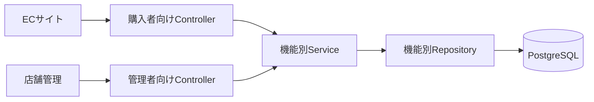

# THREAD のコード構成

THREAD は npm Workspaces で EC・店舗管理・共通 API を管理する。EC と店舗管理は React による別アプリとして起動し、1つの NestJS API と PostgreSQL を共有する。

| 場所 | 置くもの |
|---|---|
| `web/src/app/` と `admin/src/app/` | 画面ルートと共通レイアウト |
| `web/src/features/` | 認証、商品、カート、購入、注文履歴 |
| `admin/src/features/` | 認証、ダッシュボード、商品、在庫、受注 |
| `packages/shared/src/` | ECと店舗管理で使うAPIクライアント、セッション、型、表示用定数、金額整形 |
| `api/src/modules/` | 認証、商品、在庫、カート、購入、注文、レポート |
| `api/src/common/` | 認証Guard、Decorator、例外処理、リクエストログ |
| `api/src/database/` | Prismaの接続とNestJSへの登録 |
| `api/src/integrations/` | 外部サービスとの通信を追加する際の規約 |
| `api/prisma/` | DB定義、マイグレーション、標準Seed、大量Seed、性能計測 |
| `api/test/` と各画面の `*.test.tsx` | 機能の回帰テスト |
| `grading/` | DevQuestの完了条件と過去課題の回帰確認 |

機能の中ではController・Service・Repository・Moduleをそれぞれ1ファイルに置く。ControllerはHTTPと認可、DTOは入力の形式、Serviceは業務ルール、RepositoryはDB操作を担当する。購入者向けと管理者向けを持つ機能ではControllerを分ける。業務処理の共有はServiceやRepositoryを通す。

| 調べたい処理 | 最初に開くファイル |
|---|---|
| 公開商品の検索条件 | `api/src/modules/products/controllers/products.controller.ts` と `products.repository.ts` |
| 店舗の商品管理 | `api/src/modules/products/controllers/admin-products.controller.ts` |
| 店舗の在庫更新 | `api/src/modules/inventory/inventory.service.ts` |
| 注文の見積もり・確定 | `api/src/modules/checkout/checkout.service.ts` |
| 顧客の注文履歴と店舗の受注管理 | `api/src/modules/orders/orders.service.ts` |
| 売上集計 | `api/src/modules/reports/reports.service.ts` と `reports.repository.ts` |

購入確定のHTTP入口は `POST /api/orders/preview` と `POST /api/orders`。実装は購入モジュールにある。確定時にカートと見積もりを照合し、在庫の条件付き減算・注文明細の保存・カートの消去を同じトランザクションで行う。顧客が同じ注文確認 ID を再送した場合は、その顧客の確定済み注文を返す。注文履歴と受注管理は注文モジュールで扱う。

画面では、ページ・再利用する部品・状態・表示用の変換を役割が分かるファイル名で置く。片方の画面だけが使うコードはそのアプリ内で管理する。[外部サービス連携の規約](../api/src/integrations/README.md)

## DB の構成

| 領域 | テーブルと関連 |
|---|---|
| 顧客と店舗管理 | `Customer` と `Member` は別テーブルで 姓・名とメール・パスワードハッシュを持つ。ログイン先と JWT の audience に応じて参照する |
| 商品 | `Product` は `ProductCategory` を参照する。価格・在庫・公開状態は商品単位で管理する |
| カート | `CartItem` は顧客と商品の組み合わせを主キーとする |
| 受注 | `Order` は顧客を参照し 複数の `OrderItem` を持つ。明細には購入時の商品名と単価を保存する |
| 配送先 | `OrderShippingAddress` は注文と1対1で 確定時の宛先を保持する。配送先のなかった旧注文は関連行を持たない |

既存のアカウント名は空白で分割し 最初の部分を姓に 残りを名に移す。空白のない名前は元の文字列を姓に収めて名を NULL にする。購入時の配送先はプロフィールとは独立した宛先として保存する。
